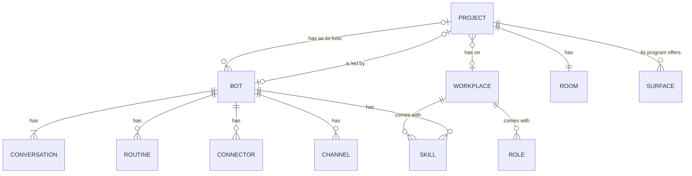

# Projects and bots are both top-level; a bot is in at most one project

Bate grew bot-first: the window's only list is bots, and a project is made from a tab of whichever bot is open. A project is not a part of a bot. We lay the objects out as a database would: the person makes two kinds of thing, **projects** and **bots**, neither inside the other; a bot is in no project or in one; every other object has exactly one owner. A bot has many conversations, and a project is the one way for bots to work together: groups go. The window opens an object from its owner, and the store keeps each relation between objects as a column or a table with a foreign key.

## The objects

| Object | Owner | Known by | How many | When the owner is deleted |
|---|---|---|---|---|
| **Project** | the app | id | any number | |
| **Bot** | the app | id | any number | |
| **Workplace** (installed) | the app | name | any number | |
| **Device** | the app | id | any number | |
| **Sign-in** to a plan, **model server** | the app | | none or one of each | |
| **Room** | project | its project | exactly one | deleted |
| Room line | room | number | any number | deleted |
| Project memory | project | file name | any number | stays: it is in the project's folder, and the files there are the person's |
| Project's program (a connector, or its workplace's) | project | its project | none or one | stopped |
| **Surface** | the project's program | address | any number | gone: surfaces are not stored |
| **Conversation** | bot | id | one or more | deleted |
| Waiting prompt, open question | conversation | its own id | any number | deleted |
| Memory note | bot | file name | any number | moved to the Trash with the bot's folder |
| **Skill** | bot, or a workplace | name | any number | a bot's: moved to the Trash with the bot's folder. A workplace's: removed with it |
| **Connector** | bot | bot and name | any number | deleted, its sign-in forgotten |
| **Routine**, and its past runs | bot | bot and id | any number | deleted |
| **Channel**, and the chats let in | bot | bot and kind | none or one of each kind | deleted, its token forgotten |
| Permission level, standing grant | bot | bot and kind | one level for each kind | deleted |
| Model, step limit, network limit, disk access | bot | its bot | one each | deleted |
| Message between bots | the two bots | number | any number | deleted when either bot is |
| **Role** | a file, in a workplace or any folder | path | | not stored: adding a role makes a bot, and no link to the file is kept |

## The relations

| Relation | Shape | Rule |
|---|---|---|
| Bot in project | a bot: none or one project. A project: 0 to 20 bots | A fact about the bot. Deleting the project leaves its bots, in no project. Deleting a bot takes it out of its project. |
| Project's lead | none or one bot | One of the project's bots. With none named, or when the lead leaves, the first bot leads. |
| Project's workplace | a project: none or one. A workplace: any number of projects | A workplace that a project has on cannot be removed. A project has a workplace or a connector of its own, not both. |
| Bot's conversations | a bot: one or more. A conversation: one bot | A new bot has one. Deleting a conversation never deletes the bot. |
| Who may message whom | follows from "bot in project" | Bots of one project. Nothing else. |

## The answers

1. **A bot is in at most one project.** A bot has one folder to work in, one memory and one set of limits, and all its conversations happen there. In two projects its commands would have two folders and its memory would mix two pieces of work. The same kind of bot in two projects is two bots made from one role.
2. **A bot may be in no project.** The simplest use is one bot and a conversation. A bot that people reach through a channel, or that only runs routines, belongs to no piece of work.
3. **A bot has many conversations.** A new piece of talk starts a new conversation; old ones are listed, named and found again. The bot's memory, skills, connectors and limits are the bot's, and are the same in each.
4. **Groups go.** A project already says which bots work together, who leads, and where the person writes to them. A group said the first two again, with nothing a person could write to. Bots that should message each other are put in one project.
5. **A role is not stored.** It is a file. Adding it makes a bot that is then the person's to change.
6. **The window follows ownership.** Its top level is Projects, Bots, Workplaces and the app's own settings. A project opens to its room, its bots, its surfaces, its memory and its settings. A bot opens to its conversations, routines, connectors, memory, skills, channels and settings. What belongs to the app (the sign-in, the model server, devices, updates, the helper, the bug report) leaves the bot's Settings tab.
7. **The store follows ownership.** A relation between two objects is a column or a table with a foreign key, so the database refuses a bot in two projects, and removes or clears the rows that pointed at a deleted object. An object's own fields may stay one JSON value.

## Considered options

- **A project owns its bots: no bot outside a project.** One tree and one top-level list. Rejected: making a first bot would need a project first, or a project made behind the person's back; the bots that exist today in no project would have to be put somewhere; and deleting a project would delete conversations.
- **A bot in many projects.** Rejected: it needs a folder, a memory and limits for each pair of bot and project, which is a second bot in all but name.
- **One endless conversation per bot**, as it was. Rejected: an old piece of talk can then be found by search only, and every open-source bot app we read keeps more than one conversation (`docs/research/ux/`).
- **Keep groups beside projects**, for bots in different projects or in none. Rejected: two ways to say which bots work together, one of them with no room to write in.
- **Leave the store as it is and change the window only.** Rejected: "a bot is in at most one project" was checked by code that reads every project's list of bots, and deleting a bot was several separate writes. A stop between them leaves ids that point at nothing.

## Consequences

- `projects.project` holds a project's bots as a list inside one JSON value. It becomes a relation: a project column on the bot. The kept data is moved once, when the service starts (#141).
- The tables keyed by `bot` already have the right shape. They gain a foreign key so that deleting a bot is one statement (#141).
- Groups are removed from the store, the protocol, the engine's system prompt and the window. The project's lead takes the part the group's lead had (#152).
- The conversation becomes an object with an id. What is keyed by bot today and belongs to one conversation (the transcript, the waiting prompts, the open questions, the engine's session) is keyed by conversation. A prompt that does not come from the window (a routine, a channel, the room, another bot) needs a rule for which conversation it goes to (#149).
- The protocol's `Project.bots` and `Bot.project` can stay as they are: the wire shape need not be the stored shape.
- The window needs a second top-level list and a place for the app's own settings (#142). How that looks is for the design system (#138).
- Deleting a project still leaves its bots. The window should offer to delete them in the same step, since bots made from a workplace's roles are of little use without it.
