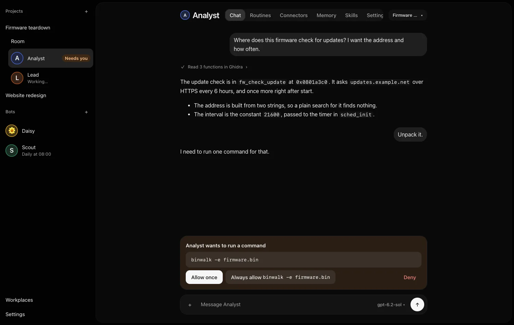

# Design system

How Bate's window looks and how its screens are built. One set of tokens, one set of components, and rules for layout and accessibility. It answers #138 and takes its inputs from the UX research (`docs/research/ux/`).

## The direction

The owner chose a chat-app look: a bot is a contact, a conversation is messages. After #292 they found it dated: a line round every control and between every two rows. The components were drawn again in #294 on one rule: **a surface is told from the next by its fill and its shadow, not by a line.** In #306 they were made compact and flat, like a tool's inspector: smaller type and controls, settings as plain rows under quiet headings, and fields that are a grey fill with no edge. In #312 the owner found the result too close to other chat apps (a centred column, a grey bubble, a black round send button, grey with no hue) and chose a work log: left-aligned, every message says who, soft-square shapes, and a lavender palette drawn dark first.

- **A ground and sheets.** The window is the ground (`--bg-side`); the sidebar lies on it. The page is a rounded sheet on the ground (`--bg`), and the side pane a second sheet beside it.
- **Fills step.** A tile or a well on the sheet is `--bg-soft`; a button on the sheet has that fill too, and on a tile, a well or anything raised it steps to `--bg-soft-2` (`--fill`, set by the surface it is on), so a button never has the fill it sits on. In dark each step is lighter, in light darker.
- **Lines are faint and few.** A field is a grey fill (`--bg-field`) with no edge: the owner's choice in #306, knowing that an empty field's fill is under the 3:1 that WCAG 1.4.11 asks of a control's edge (see Accessibility). The sheets and what floats on them (a card, a popover, a dialog) have a ring at a few percent of the text's colour under their shadow. A table in a message has one line under its head. Rows, groups and buttons have none.
- **Two colours with a meaning.** Lavender (`--ink`) is the main action, Send, a switch that is on and a working bot's dot; the chosen row and the person's message are tinted with it, and links and the focus ring (`--accent`) are a lighter or darker step of it. Apricot (`--warn`, `--warn-soft`) is what needs the person: the "Needs you" badge and the bot's question. Every grey carries a faint lavender hue. A bot's own colour shows on its avatar only.
- **Soft squares.** Buttons, fields and rows have a 6 px corner, sheets, cards and the composer 8 px, code and badges 3 px; an avatar is a rounded square. A round button (Attach, Dictate, a row's `⋯`) is the only circle.
- **One header, no bar.** The page's title (a bot's face, its name and the page it is on) stays at the head of the sheet, and the conversation at the end. The title is a button that opens the menu of pages; there is no row of tabs. Nothing else sits between it and the first message. In Bate's own window there is no title bar either: the page runs under it, the window's buttons sit on the ground above the sidebar, and that ground, the gaps between the sheets and a header's own gaps move the window (`data-tauri-drag-region`). Nothing that scrolls or opens does (the sidebar, a popover, the title), so its scroll bar and its text keep working.
- **One column, one pair of edges.** The header, the messages and the composer start and end on the same two lines, whatever the scroll bar's width; a scroll bar is thin, a quiet thumb on no track.
- **A work log.** Every page's column starts at the sheet's start edge. In a conversation each of the person's messages says "You" above it, and a bot's turn starts with its face and name. What a bot says is the page's own text, with no bubble; what the person said is a tinted block on the same edge.
- **The system's font**, 14 px on a 20 px line, 13 px for the small lines under a name; 15 px on 24 for what is said in a chat. A page's title is 20 px on 28. A settings group's heading is a quiet 14 px line in the secondary colour. Three weights: 400, 500, 600.

| Light | Dark |
|---|---|
|  |  |

The pictures are `docs/design-system/shell.html`: a static page drawn with the app's own stylesheet. Open it in a browser to resize it or to see it in dark.

Three other directions were drawn on the same screen and not chosen: one close to the Mac's own controls, one made for reading with a serif face, one dense with monospace labels.

## Rules

1. **Tokens only.** A screen or a component names no colour, size, font, radius or duration. It uses a token from `window/ui/src/tokens.css`. A value that is missing becomes a new token first.
2. **Elements first.** A plain `<button>`, `<input>`, `<select>`, `<textarea>`, `<fieldset>` or `<h2>` already looks right. A class is for a variant (`primary`, `danger`, `ghost`, `small`, `round`) or a component that has no element.
3. **No inline `style=` for looks.** Inline style is for values the code computes: a width being dragged, a bot's colour passed as `--tint`.
4. **Light and dark are the same components.** Dark changes token values under `prefers-color-scheme`, never a component.
5. **No new dependency.** See "Build or adopt".

## Tokens

All in `window/ui/src/tokens.css`.

| Family | Tokens | Use |
|---|---|---|
| Surface | `--bg-side`, `--bg`, `--bg-raised`, `--bg-soft`, `--bg-soft-2`, `--bg-soft-3`, `--bg-field`, `--page` | The ground (the window, with the sidebar on it; in Bate's own window it is `--bg-side` at 55% over the system's sidebar material, meant to let the desktop through, blurred); a sheet (the page, the pane); what floats (the composer, a card, a popover, a dialog); a tile or a well; a control's fill on a tile or on what floats; that control pointed at; the inside of a field; white under a shown file |
| Fill of a control | `--fill`, `--fill-hover` | What `<button>`, `<code>`, `<pre>` and a quiet badge are filled with. `--bg-soft` and `--bg-soft-2` on a sheet; a tile, a well and anything raised set them one step up for what is inside; the question card sets them to a shade of the text's colour |
| State fill | `--bg-hover`, `--bg-current` | Under the pointer (a row, a ghost button); the chosen row |
| Text | `--fg`, `--fg-muted` | Text; secondary text and placeholders |
| Line | `--border-field`, `--border-strong`, `--border` | The track of a switch that is off (3:1); the line under a table's head in a message; unused by a component today |
| Ink | `--ink`, `--on-ink`, `--bubble-user`, `--on-bubble-user` | The main button, Send, a switch that is on, a working bot's dot, and the text on them (lavender with white text in light, a lighter lavender with dark text in dark); the person's message (a lavender tint) and its text |
| Meaning | `--accent`, `--danger`, `--on-danger`, `--warn`, `--warn-soft`, `--mark`, `--diff-add`, `--diff-del` | Links and focus (lavender); a destructive action or an error, and the text on a filled destructive button; what needs the person and its fill; a search hit; the fill of an added and of a removed line in a diff |
| Depth | `--shadow-0`, `--shadow-1`, `--shadow-2`, `--scrim` | A sheet on the ground (a faint ring); what floats on a sheet (a faint ring and a soft fall); a popover or a dialog; behind a dialog. In dark a shadow is a faint light ring, and a fall only under a popover or a dialog |
| Type | `--font-ui`, `--font-mono`, `--size-small` 13, `--size-ui` 14, `--size-chat` 15, `--size-title` 15, `--size-head` 20 (a page's title), `--size-display` 28 (the first run's title), `--leading` 20, `--leading-small` 18 (the 13 px lines of a row), `--leading-chat` 24, `--leading-head` 28, `--leading-display` 34, `--weight-strong` 600, `--tracking-head` | Chat text is 15/24; everything else 14/20. Code is never under 12 px |
| Space | `--space-0` to `--space-6`: 2, 4, 8, 12, 16, 24, 40 | A 4 px grid and one half step |
| Shape | `--radius-s` 3, `--radius-m` 6, `--radius-l` 8, `--radius-bubble` 6, `--radius-pill` | Code, badges and small things; buttons, fields, rows, tiles and avatars; sheets, wells, cards, the composer and dialogs; the person's message; a round button and a switch |
| Size | `--control-h` 32, `--control-h-small` 28, `--row-h` 36, `--row-h-l` 44, `--head-h` 56, `--titlebar-h` 40 (room for the window's buttons above the sidebar, in Bate's window), `--avatar` 24, `--avatar-l` 28, `--side-w` 260, `--thread-w` 720, `--reply-w` 640, `--popover-w` 300, `--nav-w` 180, `--chip-w` 180, `--tip-w` 240, `--switch-w` 32, `--switch-h` 18, `--control-w` 220 (a select or input in a settings row), `--control-w-short` 112 (a number of up to seven digits) | |
| Motion | `--fast` 100 ms, `--slow` 180 ms, `--spin` 900 ms, `--beat` 1400 ms, `--ease` | Hover and press; a message arriving; the working marks turning and breathing (stopped, not shortened, for reduced motion) |

## Components

All in `window/ui/src/style.css`. "Built" means it is there now; a number is the issue that builds it.

| Component | How to write it | States | Built |
|---|---|---|---|
| Button | `<button>`: a rounded rectangle with a fill and no edge (`--fill`). `primary` is filled with `--ink`; `danger` is its colour as text with no fill until pointed at (filled with `--danger` in a dialog, where it is the one thing the dialog is for); `ghost` has no fill; `small`; `round` (one sign, a circle, needs `aria-label`). A form's submit button is primary by itself. Disabled is dimmed with a `not-allowed` cursor | hover, pressed, disabled, focus | yes |
| Text field, select | `<input>`, `<textarea>`, `<select>`: a grey fill (`--bg-field`) with no edge and an 8 px corner, `--control-h` high; the focus ring says where the words go. A select is its value with a small chevron in `--fg-muted`. In a form, `.fields` with one `<label>` per control; `.fields.stack` puts each label over its control, as wide as the column | placeholder, disabled, focus | yes |
| Form row with hint, error and "Saved" | `Field` (`Form.tsx`): a `.field` with a `<label>` over one control, a `<small>` hint and a `<small class="error" role="alert">` under it; the control takes the label's id and describes itself by both. After a save `<Saved>` puts "Saved" beside the control (a `role="status"` region that is always there) until the next edit; an error stays by the control that caused it (`useSaves` keeps both by key). Each form ends with `.actions`: Save, then "Saved". Settings screens use `Setting` and `Group` (next two rows) instead; `Field` stays for the channels and pairing forms | placeholder, hint, error, saved, disabled with the reason in the hint, focus | yes |
| Settings group | `Group` (`Form.tsx`): `<section class="group">` with an `<h2>` (a quiet line in `--fg-muted`, with an `id` and `tabindex="-1"` when the app's nav jumps to it) over its `.group-rows`, flat on the sheet with no well and no line between rows: each row's height and the space round it part them. Settings of a bot, a project and the app are all groups. A bot's grants are three: "Always allowed", "Allowed in one conversation" (each row names its conversation) and "Blocked tools" (each with **Unblock**); each has a **Remove** or **Unblock** button on its row, and the last two show only when they have a row. A bot's "Secrets" group (in Bate's own window only, never on a device) has a row for each secret, its name with its site in a `<small>`, and **Remove**, or a `.note` when there is none; never a value. A `<fieldset>` (in a dialog) is flat too, its `<legend>` a heading over its rows | | yes |
| Settings row | `Setting` (`Form.tsx`): a `.setting`: on the left a title and one `<small>` hint (and the error, in `role="alert"`), on the right its `.control` (a switch, a select or input `--control-w` wide, a button). A select there reads as its value at the row's end, its fill showing when pointed at. A text field with no hint sits on the title's line and takes the rest of it ("Name [field]"); with a hint it goes under the title, as wide as the column (`short` keeps a number at the end). A button there is small by itself, with no `small` class; beside a text box or a select it keeps the box's height. A lone input, select or textarea takes the title as its label and describes itself by hint and error. `wide` puts a text area or a long line under the title; `inline` keeps a button beside the title. When the main area is 480 px wide or less (a phone) every control but a switch or a button goes under the title, as wide as the column, a select with its fill. After a save `<Saved>` shows beside the control | hint, error, saved, disabled, focus | yes |
| Switch | `<label><input type="checkbox" role="switch"> Analyst</label>`: a checkbox that takes effect at once, with its words in the label. A checkbox that is only part of a form stays a checkbox | on, off, disabled, focus | yes |
| Page menu | The page's title, which is also how to change page (`RowMenu.tsx` with `title`; `PageMenu` in `main.tsx`). `<h1><button class="title" aria-haspopup="menu" aria-expanded>` holds, for a bot, its avatar and `.name`; then, when the page is not the first one (Chat, Room, Connectors), the page's name in `.page` (`--fg-muted`, regular weight); then a small `▾` (`aria-hidden`). Under it a `.popover.dropdown.start` of `role="menu"` lists the pages (the same as the palette's "In …" lines; Channels and Surfaces in Bate's own window only), each a `.row.plain` button with `role="menuitemradio"`: the current one has `aria-checked="true"` and the `current` fill, and choosing one opens that page and closes the menu. The button has no fill until it is pointed at (`--bg-hover`); its padding is taken back on the left so the first word starts on the column's edge. Keys as in Row menu: Enter or Space opens it with the first item in focus, arrows, Home and End move, Enter chooses, Esc or a click outside closes it and the focus goes back to the title. A long name is cut with `…`; the page name and the project's name are cut before the bot's | closed, open, hover, current, focus | yes |
| Header | `main > header`, `--head-h` (56 px), one row in the column's width, staying at the head of the sheet while the page scrolls under it: `.who` (the page's title at 20 px). A page with pages (a bot, a project, Add-ons) has the Page menu as its title; a bot in a project has the project's name before it, a `button.crumb` in `--fg-muted` that opens the project's Room, then a muted `/`. Other pages have a plain `<h1>`. There are no tabs. For a bot's Chat the conversation chip is at the end (at the column's end edge however short its name). The header's own space and `.who` move the window; the title button and the project's name are buttons and do not. Over the app's settings, which are wider than a column, it is as wide as that page | | yes |
| List row | `.row` with an `.avatar` and a `.label` (a name and a `<small>` line under it); `current` for the chosen one, which changes its fill only: its weight and width stay. In the sidebar a bot's row is `--row-h-l` high and its face `--avatar-l`. A row to tick is `<label class="row">` with a checkbox before the avatar; one that cannot be ticked is dimmed and its `<small>` says why | hover, chosen, disabled, focus | yes |
| Badge | `.badge` at the end of a `.row`, or under the name inside a bot's `.label` in the sidebar (a long name keeps its width): one word on its fill, with no dot. Plain (warn) for what needs the person: "Needs you". `.badge.quiet` for what does not: "New reply", "Paused" (a paused bot shows it in place of "Working…" and "New reply"). A working bot has no badge: its `.label` has a `<small>Working…</small>` line and its row ends in a `.pulse` dot. In a routine's row it is how its last run ended: "Sent" and "Skipped" quiet (a `<small>` gives the reason: "The bot was paused."); "Failed", "Missed", "Stopped" (the step limit) plain, with the reason in a `<small class="error">`. A routine held back after failed runs has a second `.badge.quiet` after it: "3 failed in a row, next run Tomorrow 09:00" | | yes |
| Sidebar | `<nav class="sidebar">`: a `.heading` for each section (Projects, Bots), each with its `+` beside the `<h2>` (a `round ghost` button; there is no "New project" row), a `<ul>` of rows, a nested `<ul>` for a project's bots, `.row.plain` for a row with no avatar, and `<ul class="foot">` for the app's own pages at the bottom. Above the first heading one `.row.plain` "Activity" with a `.badge` "2 need you" while a bot waits. In the strip under 640 px the headings stay, each right before its `+`: a bare `+` does not say what it adds | hover, chosen (`current`, with `aria-current`), focus | yes |
| Rows of settings or items | `<ul class="rows">`, each row at least `--row-h` high. A row is a `.what` (a `<strong>` name, then a `<small>` per fact, 12 px) and `.actions` at the end with at most one visible button, or a switch, and the `⋯` menu for the rest; a nested `<ul class="rows">` under it (in a `
` when there are many) has one line for each bot or project that has it, with a switch. A routine's row adds a switch and its `.badge` after the name, and a `
` ("Past runs") whose lines are a nested `<ul class="rows">`. It is the one row with a button and a switch: a small **Test** runs the routine now, and the new last run shows in the row. A run skipped because a connector is signed out has a small button in the `.what`, "Sign in to <connector>", the one the Connectors page has; a routine with a precheck has a `<small>` "Checks first: <code>command</code>". Times read "Today 08:00", "Tomorrow 08:00", "Yesterday 11:41" (`times.ts`) | | yes |
| Later turns | The turns a bot set itself with `check_back`, waiting for their time. On the Routines page, under the routines: an `<h3>` "Later turns", a `.note`, then a `<ul class="rows">`: each row has a `.what` (the time as a `<strong>`, "Today 14:30", and the note in a `<small>`) and one small **Cancel** (its `aria-label` has the note). In the chat, above the composer, the same turns as the `.queue` chips of the waiting prompts: an `<ol class="queue" aria-label="Later turns">`, each `<li>` the time in a `<strong>`, the note, and a `×` button that cancels it. Nothing is shown when none waits. Both load with `useLater.ts` and load again on `later_changed` | none, one, many | yes |
| Routine that follows a bot | In the routine's dialog, under "What starts it": the checkbox "After another bot" (it and "A schedule" turn each other off), and when it is on a `.field` "Bot" (a `<select>` of the other bots), a `.field` "When its turn" (finishes, fails, ends either way) and a `.note`. In the routine's row the `<small>` that says when it runs reads "After <bot name> finishes a turn" in place of the schedule; a run it started says "(after another bot)" and a skipped one says why ("The bot was busy.", "Held back: it already started 20 times in the last hour.") | off, on | yes |
| Note, opened in place | A row of `.rows` (the note's first line as `<strong>`, its file name, size and time in the `<small>`) with **Open** and, in its `⋯` menu, **Delete** (which asks in the row first). **Open** shows a `<form class="fields stack">` in the same `li`, with Save and, once the text differs, Discard changes and a line saying it is unsaved; "Saved" shows after a save and an error under the form. Unsaved text is kept when the tab or the bot changes and comes back with a line saying so; while it is unsaved no other note opens | closed, open, unsaved, saved, error | yes |
| Note history | In a note's `⋯` menu, **History** (then **Hide history**) shows a `.versions` block under the row, set in with the rule the folded calls use: a `<small>` "Earlier versions", then a `<ul class="rows">` with a line for each earlier version, newest first: `.what` with the time as a `` and a `<small>` with its size and who changed it ("you" or "the bot"), and a `small` **Restore** at the end (disabled while the open note has unsaved text). Under the notes a closed `
` "Deleted notes (n)" lists the notes that are gone as `.rows` with **Restore** (their newest version) and the same `⋯` History. Restoring keeps what it replaces as another version. No versions yet: a `.note` saying one is kept at each replace or delete | closed, open, loading, empty, restoring, error | yes |
| Row menu | `RowMenu.tsx`: `button.round.ghost` "⋯" with `aria-label="More actions: <row name>"` and `aria-haspopup="menu"`, over a `.popover.dropdown` of `role="menu"` with a `role="menuitem"` button (`.row.plain`, `.danger` for Delete or Remove) for each item. It holds everything a row does beyond its one visible action, Delete included. A bot's row in the sidebar has one (`li.bot`): Pause or Resume. A pointer sees its "⋯" while the row is pointed at or has the focus; under 640 px, where the sidebar is a strip that scrolls, there is none (the bot's Settings has Pause). The first item takes the focus; arrows, Home and End move it; Esc or a click outside closes it and the focus goes back to the "⋯". Wrapper `.menu.more`; under 640 px the menu opens to the left | closed, open, item focused, danger | yes (memory, routines, connectors, skills, workplaces, the sidebar's bots) |
| List head | `.head`: the list's `<h2>` and, at the end, its one `small` button (or two for a list that can be reloaded). It replaces the opening paragraph; a list has no more than half a line of note | | yes |
| Connector row | One `<li>` of `.rows`: `.what` (name, then the address in a `<small><code>`), `.actions` with the `⋯` menu (Add to bots…, Remove…), and under them a closed `
` whose `
` says "On for 5 of 6 bots" (and, in the error colour, how many need a look). Opening it shows one nested row for each bot: its switch, its state in a `<small>`, Sign in or Sign out and, once the bot's engine has loaded the connector, a closed `
` "2 tools" (", 1 blocked") with a row for each tool: its own name in a `<code>`, a `<small>` ("Not blocked", or "Blocked: …"), and a **Blocked** switch (`role="switch"`, labelled with the tool and the bot). A bot on an installed agent has no tool list. A workplace's row is the same, with "On in 1 of 2 projects" | closed, open, problem | yes |
| Avatar | `.avatar` with `--tint` set to the bot's colour | with a sign, with a letter, without a colour | yes |
| Message | `.item.user` or `.item.reply` with a `.bubble` (15/24), all from the column's start edge. Above it a `<small class="from">` says who: "You" over each of the person's messages; the bot's avatar and name over the first thing it does after one (in the Room, every message, with "to" whom and the time). `.actions` under it (with a pointer, a message of the person's has them at the end of its "You" line, so they take no room); a message of the person's has more room above it, as it starts a turn; a message that just arrived fades in (`.arriving`). A reply has no bubble: it is the page's own text, as wide as the column. The person's message is a tinted block (`--bubble-user`). Code in a reply is a `<pre>` on `--fill` with no edge; a table has a 600 header with one line under it | past (greyed), marked (a search hit), arriving | yes |
| Run of calls | `.item.run` with `
`: a `
` of a `.mark` (`spin` while the bot is at it, `ok` ✓ when done, `bad` ✕ when a call failed), what happened in the person's words ("Ran 3 commands, read 1 file"; "Running 2 commands" while it goes), a red ", 1 failed" when a call failed, and a chevron. Calls that follow each other, and the thinking among them, are one run (`fold` in `chat.ts`); a plan is its own checklist (`.item.plan`) and ends the run. Opened, a `<ul>` set in under the summary has a row for each call, named by the command, the path or what was searched (`aim` in `chat.ts`), which opens to the call's arguments and output, and the thinking as plain text | closed, open, running, done, failed | yes |
| Check line | `.item.checked`: one quiet line (`--fg-muted`, small) of what a check said, in the conversation where it happened and kept after a reload: "Checked: nothing to fix.", "Checked: something to fix. <notes> The bot is working on it.", "Checked: this did not pass, and the answer stands as it is. <notes>" or "Not checked: <why>". It is its own line (`checkText` in `chat.ts`), never inside the bot's message. The line says who checked: "Checked by <model or bot>: nothing to fix.". In Settings, the "Check" group has one `<select>` row ("Check answers before the turn ends": Off, its own model, a model, or a bot of its project); a choice that cannot be used now is shown as it was saved with the reason in the row's error; outside Bate's own window the select is disabled and says so; for a bot on an installed agent the group holds a `.note` in its place | passed, failed, not passed, not checked; select off, chosen, broken, disabled | yes |
| Undo line | `.undo`, at the end of the row of a call that kept the earlier file (a `write` or `edit` whose `tool_end` has `undo`; only in Bate's own window), on the same row as the file name; it wraps under the name when the row is narrow. A `small` **Undo** button. Used, the row shows `<small class="note" role="status">Undone</small>` in its place, also after a reload (the `undone` entry). A file that is no longer as the change left it is not overwritten: `<small class="error" role="alert">No longer as the bot left it.</small>` and a `small danger` **Undo anyway**; another failure shows the service's message and keeps Undo. A call with no copy (a long file, a failed call) has no Undo | Undo, busy, undone, changed since, failed | yes |
| Working mark | `.item.working` under the last message while the bot works and no question waits: `.dots` (three dots that breathe) and "Working…". On the bot's row in the sidebar a `.pulse` dot beside "Working…". Both stand still with reduced motion | | yes |
| Card | `.card`: what floats on the sheet (`--bg-raised`, `--shadow-1`: a faint ring and a soft fall). `.question` is the approval card of a risky action, kept in view above the composer (`position: sticky`) and the one thing on the page washed with the colour of what needs the person (`--warn-soft` over `--bg-raised`; the fills inside it are a shade of the text's colour, so they are of its hue): the title (wraps as written; it scrolls inside the card past 5 lines), the exact command or file in a `<pre>` (all of it, wrapped; it scrolls inside the card past 10 lines), a `.warning` line when the title or the target holds a character nobody can see or that changes the reading order (each such character is drawn in the text as its code point, `U+200B`, in a `mark.hidden-char`: `--warn-soft` and `--warn`, so it cannot be taken for text), `In <code>folder</code>`, a `.note` "Asked for by <bot>" (a chain reads "Asked for by B, who was asked by A") when another bot asked for the work, then `.actions` with **Allow once** (`primary`), **Allow in this conversation** (the same exact action, until the conversation ends), **Always allow `<target>`** (the exact command, path or tool the grant covers; its first line, cut at 32 characters, because the card shows all of it above) and **Deny** (`danger`, set apart at the end). No paragraph explains them: the keys (⌘Enter allows once, Esc denies; the first card only) and what Always covers and that the bot asks again for anything else are the buttons' tooltips. Nothing in it has focus when it appears. Allowing by key is the chord ⌘Enter, never Enter alone | Always and Allow in this conversation are absent for an action that always asks and for work another bot asked for (the service sends no such option); Allow in this conversation is also absent in a routine's run | yes |
| Secret card | `SecretCard` (`Question.tsx`): the `.question` card of a secret a bot asks for (`secret` on the question), kept in view like the approval card. The title says what for; a `.note` names the exact site (its host) and the name it is saved as; one `<input type="password">` (`.question input`: full width, `--space-2` above) holds the value, never shown and cleared when sent; **Save** (`primary`, off while the field is empty; Enter does it too) and **Deny** (`danger`, Esc on the first card) in `.actions`. On a device (not Bate's own window) there is no field and no Save: a `.note` says the value is typed on the Mac, and only **Deny** is there. A notification for it has no buttons and names only the bot and the site | empty, typed (dots) | yes |
| Composer | `<form class="composer">`: one tinted bar at the log's foot (`--bg-soft`, an 8 px corner, no shadow) holding round buttons, one `<textarea rows="1">` that grows, the model chip (a popover) beside it, and **Send**. The round buttons are Attach (`+`) and Dictate (a microphone: one inline `<svg viewBox="0 0 24 24" aria-hidden="true">` in `currentColor`; only in Bate's own window), each with an `aria-label` and a tooltip. Send is the form's submit button, so it is primary by itself. While the bot works, a `primary` **Stop** (its tooltip names the Esc key) takes the place of Send; the field stays, and its placeholder is the tip: Enter queues the message for when the bot is done, ⌥Enter puts it into the turn that runs (an installed agent has no steer). While an approval card waits the placeholder says that a typed message denies it. Its bar, its placeholder and its buttons say where to type, so it has no field's fill: a 2 px ring of `--accent` shows while the box has the focus; what acts on the whole conversation (Compact, Export) is in the conversation switcher. The Room's has no chip for a model: typing `@` opens a `.popover.start` listing the project's bots as `.row.plain` options, and the pick becomes a `.mention` (an avatar, `@name` and a remove button, like an attached file) in front of the words; Enter picks while the list is open, Esc closes it, Backspace on an empty box removes the pick. Esc stops the bot while it works (Esc denies instead while an approval card waits). The Room's box has `.hints` under it saying where a message with no `@` goes | empty, typing, bot working, focus | yes |
| Note, error line | `.note`, `.error` (with `role="alert"`) | | yes |
| Keychain notice | A `.note` (`role="status"`) with a `small` **Ask again** button, only while macOS has refused the service its secrets; in the ChatGPT group of Settings under its error line, and in the chat under its error line. Not shown on another device | hidden, shown | yes |
| Banner | `.banner`, `.banner.error`; `.banner.actions` when it offers a button (`<button class="small">`; a paused bot has one above the composer: "<bot> is paused." and **Resume**, with Send off and the placeholder "Resume the bot to send a message"), as the Room's line "<bot> is working" with its Stop does. A bot that waits for an answer has no banner: the sidebar's badge says it | | yes |
| Activity | `Attention.tsx`: the page "Activity" (sidebar row, palette line, and the phone strip's first button). One `.group` (an `<h2>` and a `<ul class="attention">`) for each of Needs you, Working, Done since you last looked and Failed, in that order; a group with no card is not drawn, and with none at all there is one `.empty` line. A card is an `<li class="card">`, drawn as a tile (`--bg-soft`, no shadow): one `.row.open` button (the bot's avatar, its name with the conversation's title in a `<small>`, then the last line or why it failed, at most two lines, and `<small class="when">` with how long ago), which opens the conversation, and, in Needs you, the question under it with its own buttons (the same `QuestionCard` as the chat, so a question that must always be asked has no Always there). The question has no box of its own here: the whole tile takes the wash of what needs the person. Tab goes through the cards in order and Enter opens one; the `.question` is not sticky here. A conversation is in the first group that fits: question, running turn, then how its last turn ended. The number of cards in Needs you is the Dock icon's count and the one the sidebar's Activity row shows (`needsCount`). The system's notification for a waiting question has **Allow once** and **Deny** buttons only for a kind of action that can be granted, with both plain choices and no hidden or direction-changing character in anything it shows (`noticeFor`); any other question's notification opens the window, and a target that does not fit is cut with a note saying so. | hover, focus, empty | yes |
| Starter card | `<ul class="starters">` of `<li><button type="button" aria-pressed>`, each with an `.avatar` and a `.label` (a name and a `<small>` line). A card fills a form; it is not a link | hover, chosen (`aria-pressed`), focus | yes |
| Empty state | `.empty`: one sentence, then one action | | yes; per screen with its issue |
| Install sheet | `Sheet.tsx`, the one sheet for installing, adding to more bots and removing an add-on: `<h2>`, what it is, **Made by**, **What it is**, **What it may do**, a line saying what is downloaded ("Nothing is downloaded until you agree"), then a `<fieldset>` of tickable rows (`Install for`, `Switch it on in`, `Remove from`) with Select all, and `.actions`: the confirm button (`danger` for a removal) first, Cancel after. A failure for one bot stays in the sheet, with that bot still ticked. `blocked` (why it cannot be done) shows in `role="alert"` and turns the confirm button off | | yes |
| Adapter row | `AdapterRow.tsx`: a `Setting` in a bot's Settings, Engine, for an agent whose adapter Bate can fetch. Not installed: **Install…**. Installed by Bate: its version in the hint (and that the person's own copy comes first on the PATH, when it does) with **Check for updates** (on a click only: says "Up to date", or opens the sheet to update) and **Remove…**. Both open the Install sheet with no rows to tick; with no usable Node it is `blocked` with what is missing | not installed, installed, up to date, own copy first, blocked, failed | yes |
| Confirm dialog | `Confirm.tsx`, a Dialog with a title, one sentence saying what happens, and `.actions` with the `danger` confirm button first and Cancel after. Cancel holds the focus, so that Enter does not do it; a failure stays in the dialog | busy, error | yes (a bot's Delete) |
| Code block | `CodeBlock` (`Form.tsx`): `.codeblock` with the text in a `<pre>` and a small **Copy** button. Where the clipboard is not offered (a page served over plain http) the text is selected for ⌘C and the line says so | copied | yes (pairing codes, the certificate's fingerprint, an agent's install command) |
| Settings of the app | `.settings`: a `<nav aria-label="Settings sections">` of `.row.plain` buttons (`aria-current` on the chosen one) and, beside it, every section in one scroll, each a `Group`. A button in the list chooses the section, scrolls to it and puts the focus on its `<h2 id="settings-…" tabindex="-1">`, which is also where ⌘K puts the focus. The list stays in sight (sticky); its words start at the title's edge and its first row is centred on the first section's heading. Under 640 px the list is a strip across the top. The first section, Appearance, has one `<select>` "Colours": Same as macOS, Light or Dark. It is only in Bate's own window: the shell sets the whole app's appearance (`set_app_theme`), so every window and the window's own frame change at once; the choice is kept in the page's storage and set again when a window opens | chosen, loading | yes |
| Quick Ask panel | `<section class="quick">` (`QuickAsk.tsx`) that fills the small floating panel the shell opens (`window.__BATE_QUICK__`; about 560 by 340 px, always that size). Asking: a `<form>` of a bot `<select>` with its `.avatar`, one `<textarea>` (Enter sends), the `.attached` pills for the quote (`Selected text: “…”`) and the screenshot (`Screenshot of` the screen or a window), a `.note` for what a switch could not take, and `.foot` with a `<small>` of the keys and a **Send** button. Answering: a `<header>` with the bot and a `small` **Open in Bate**, the question in `.asked`, `.answer` with a `.bubble` of Markdown (it scrolls), the working mark, the `.question` card, and an `.error` or `.note` for how the turn ended. Esc closes it | empty, answering, question, with a quote and a screenshot, error | yes (#229) |
| Dialog | `Dialog.tsx`: a `<dialog class="sheet">` opened with `showModal()` and holding one `<form>` (a `.fields.stack` one for a form): the dialog is the scrim, the form the panel, `.actions` stay at the foot while it scrolls. Focus goes to the first field, stays inside, and returns to the button that opened it; Esc or a click on the scrim closes it. Projects, the install sheet, the confirm dialog and the palette are all built on it. A form of fields only (a routine's) is `Sheet.tsx` with its fields as children | scrolling | yes |
| Palette | `<Dialog className="palette">` (⌘K) around one `<form>`: a search `<input role="combobox">` over a `<ul role="listbox">` of groups (`<li role="group" aria-label>` with a `<small>` name and a `<ul>` of options). An option is a `<li role="option" class="row">` (`row plain` when it has no avatar and no second line) with an `.avatar`, a `.label` (the name, a `<small>` under it) and, at the end, the key that does the same as a `<kbd>` (hidden under 640 px). Arrows move the choice (`aria-selected`, focus stays in the box), Enter runs it, Esc closes (the dialog's own). A `.note` says "Searching conversations…", an `.error` says why the search failed, and `.empty` says nothing matches, with a button to clear the box. Its commands include **Pause all bots** (while a bot is not paused) and **Resume all bots** (while one is) | choice, searching, no match, failed | yes |
| Palette, before typing | Until something is typed the palette lists only the five lines picked last, under "Recent" (kept in `localStorage` by `recent.ts`; with none, the "Commands" group). Typing shows everything that matches, as above, and the words in conversations. The search box has no outline: its focus is a 2 px accent line under it | recent, none yet, typing | yes |
| First run | `<section class="first-run">` in the middle of the page, one card: `<h1>`, one line, one `primary` button (Sign in with ChatGPT), a closed `
` "Use a model server instead" holding the URL, Model and API key fields and **Use this server**, a `ghost` "Set up later", and the error line | closed, open, error | yes |
| Messages between bots | `
` above the conversation, closed, its `
` giving the count of open ones. One `<ul class="rows">` line each: `.what` (who, when, the text, then a `<small>` with the answer or an `.error` with why there was none; a hand-off with an acceptance command adds a closed `
` under the text: its `
` is "Check: <code>the command's first line</code>, Passed" (also Waiting for you, Running, "Failed, the bot tries again", Failed, Not run; `.error` when Failed), and opened it shows the whole command in a `<pre>` with its hidden characters marked, a `<small>` with how it failed or why it was not run, and what it printed in a `<pre>`) and `.actions` with a `.badge` (Waiting, In progress, Answered: quiet; No answer: plain) and, while waiting, a small Cancel. A failed Cancel says why under that message. No messages: nothing is shown | waiting, working, answered, no answer, cancel failed | yes |
| Pairing page | What a device sees before it is paired: `<main class="pair">` with one `.card.fields.stack` form: the title, what to do on the Mac, the Code field (its error right under it), the device's name with a `<small>` saying what it is for, and Pair (disabled and "Pairing…" while it asks; "Paired. Opening Bate…" after). It has no commands to hide: nothing else is on the page until the device is paired | busy, error, paired | yes |
| Tooltip | `data-tip="…"` on a control; the text is shown above it for a pointer or the keyboard, and not on a touch screen, so it never holds the only copy of something a button must say | hover, focus | yes |
| Button with a hint key | `<button>Stop <kbd>Esc</kbd></button>`: the key that does the same, hidden under 640 px | | yes |
| Popover, select with search | `.menu` around a chip (`<button class="small chip" aria-expanded>`) and a `.popover` (`role="dialog"`) holding a search `<input>`, a `<ul role="listbox">` of `.row.plain` buttons and other controls. A click outside or Esc closes it; Esc is taken there and does not reach the page | closed, open, chosen row, no match | yes |
| Conversation switcher | A chip (the conversation's name) at the end of the header, drawn there by `Conversations` through a portal into `
`; its `.popover.below.end` lists the bot's conversations as `.row.plain` buttons with a date under the name (or "Working…") and a drawn pin (`.pin`, an inline `<svg>`) before the name of a pinned one. Each row has one `⋯` button (`.ghost.small.more`, shown when the row is pointed at or has the focus, always on a touch screen) that opens its `.actions` under the row: Pin, Rename, Archive (Esc closes them first). Then a "Show archived" checkbox and a `.foot`, set apart by a gap: "New conversation", "Export chat" (the chat shows where it was saved as a `.note`) and "Compact this conversation" (gone while the bot works or for an installed agent, disabled while a message goes out; the chat shows the result as a `.note`). A rename is a one-field form in the row | closed, open, chosen row, row's actions open, working, pinned, archived, renaming | yes |
| Folder picker | A text box for the whole path (`<input class="path">`, at least `--control-w` wide) with a `Choose folder…` (or `Choose file…`) button beside it, in a `.field` (a label over a `.find`). Where the form is too narrow for both, the buttons go under the box, so the placeholder is never cut. The button asks the shell for the system's open panel and fills the box; it is only there in Bate's own window, so the typed path is the way on another device | | yes |
| Side pane | `<aside class="pane">` (`Pane.tsx`) to the right of the main area: a `.pane-head` with an `<h2>` (the title, cut in the middle when long so its end stays; the full title on hover) and a `round ghost` Close (`×`, tooltip `Close (Esc)`), then the content. A grip on its left edge resizes it (arrows too). Focus moves into the pane when it opens and returns to what opened it; Esc closes it (before it stops a bot). Esc does not reach the page from inside a shown file's frame, so a Close button (`.leave`) follows the frame in the Tab order and shows only while it has the focus. Under 860 px it is a sheet over the conversation with a `.scrim` that closes it | beside, sheet, dragging | yes |
| Changes view | `Changes.tsx`, shown in a `Pane` titled "Changes: <bot>" (only in Bate's own window; a bot's conversation menu has **Show changes**, and a run that wrote files ends with a quiet `
` "Changed 2 files" and a small **See changes** button). `.changes` holds `.tools` (a `.note` saying where the list comes from, and a small **Reload**), a `.banner` when the list may be incomplete (a bot's own folder, with no Git) or when Git is not installed, then `ul.files`: a file is a `
` (open at first when there are 5 files or fewer, or when it has a comment) with its path in `<code>`, a `.badge.quiet` (New, Changed, Removed) and its `+n −n` counts. Opened, it shows a `table.diff` (`aria-label="Changes in <path>"`): a `tr.hunk` for each `@@` line and a row for each line with its number in a `button` (`aria-label="Comment on line 3"`) and its text. Added rows are `--diff-add` and removed rows `--diff-del`, and each text also starts with `+` or `-`, so colour is not the only sign. A click on a number, a shift-click or a drag over several chooses lines (`.chosen`); a `tr.compose` opens under them with a `<textarea>`, **Add comment**, Cancel and small **Line above** and **Line below** (Esc cancels it and does not close the pane). A commented line is `.marked` (a line on its edge). A binary or large file is named with a `.note` and not shown. A footer `section.comments` (kept in sight under the list) is a `
` "3 comments" that opens to a `ul.rows` of them (each with a small **Remove**), with **Send comments to the bot** (primary) and **Discard**. Comments are kept in `localStorage` per bot and conversation until sent or discarded. Sent, the whole list is one message in the chat | collapsed, open, loading, error, line chosen, commented, sending, sent | yes |
| Surface rows, surface view | The Surfaces page: `<ul class="surfaces">` with one `.row` button for each surface (`aria-pressed` and `current` for the one open in the pane): its name and, in a `<small>` under it, its kind and its description. None, or a failure with the service's reason: `.empty` with one button (See workplaces, Try again). `.surface` in the pane: `.tools` (the program's actions; one that takes words is a `.find` form; `.pager` with Previous and Next only when there is more), a line for the result of an action (Done, Saved, or the error), then `.body` holding a `<table>` (sticky head), a `role="tree"` list (indent by `--depth`, a ghost small toggle) or a `.code` view with line numbers. A table's cell stays on one line; one of more than 32 characters (`td.long`) wraps, at least `--control-w` wide, so that two columns need no sideways scroll in a narrow pane. A row, node or line that can be chosen has `aria-selected`: pointed at (`--bg-hover`), chosen (`--bg-current` and a stronger weight). Rows are `--control-h` high | loading, empty, error, chosen, focus | yes |
| Toast | | | not built: #150 needed none; a failure is a line in the sheet or beside the list |
| Loading | A `.note` saying what is loading; no spinner | | yes |

## Layout

Three regions in one grid: sidebar, main area, side pane.

| Region | Size | Rule |
|---|---|---|
| Ground | The window, with 8 px round the sheets | `--bg-side`. The sidebar lies on it; the sheets are rounded (`--radius-l`) |
| Sidebar | `--side-w`: 260 px, 220 px under 900 px | Sections with a small heading; a bot's row 44 px high with a 28 px face, as wide as the sidebar, with one padding so its words never move; its `⋯` lies over its end on a fill of its own, and the working dot fades while the `⋯` shows. Any other row is 32 px; what is new goes at the bottom. In Bate's window it starts `--titlebar-h` down, under the window's buttons |
| Main area | The rest, a sheet | Every screen is one column of at most `--thread-w` (720 px), from the sheet's start edge. The conversation (a bot's or a project's) fills the sheet however wide the window: its header, the composer, cards and calls reach the end edge, and a message's text keeps `--reply-w`. The conversation's scroller is as wide as the sheet, so its bar is at the sheet's edge; the messages in it keep the header's edges |
| Side pane | 480 px, dragged wider or narrower, a second sheet | The grip is the 8 px between the two sheets. Under 860 px it lies over the conversation (`pane.ts`) as a sheet with a scrim |

Widths the page must work at: 1200 px and more, 900 px, and 390 px (a phone, since the page is also served to other devices), and Bate's window at its first size, 1000 by 700. Under 640 px the sidebar becomes a strip across the top that scrolls sideways: Activity, "Projects" and "Bots" each with its `+` and its rows, then the app's pages. The header stays one row at every width: when it is short, the conversation chip's name is cut first, then the title's.

## Accessibility

- **Contrast**, worked out from the tokens by `window/ui/src/tokens.test.ts`, which fails when a pair goes under its floor (WCAG needs 4.5:1 for text, 3:1 for the edge of a control):

  | Pair | Light | Dark |
  |---|---|---|
  | Text on the page | 17.8 | 16.3 |
  | Text on a tile or a well | 16.2 | 14.9 |
  | Secondary text on the page | 6.4 | 7.9 |
  | Secondary text on the ground (the sidebar) | 5.8 | 7.1 |
  | Secondary text on a tile or a well | 5.9 | 7.2 |
  | Secondary text on a control's fill on a tile | 5.4 | 6.3 |
  | Secondary text on the chosen row | 5.2 | 5.8 |
  | Text on the main button | 6.5 | 7.3 |
  | Link on the page | 6.9 | 9.5 |
  | Link on a tile or a well | 6.3 | 8.7 |
  | Error text on the page | 6.5 | 7.5 |
  | Error text on a tile or a well | 5.9 | 6.8 |
  | Warning text on its fill | 7.4 | 8.6 |
  | Text on the person's message | 15.4 | 12.7 |
  | Text in a field | 15.2 | 13.9 |
  | Placeholder in a field | 5.5 | 6.7 |
  | Track of a switch that is off, on the page | 3.6 | 3.9 |
  | Track of a switch that is off, on a tile or a well | 3.3 | 3.6 |

- **A field's fill is under 3:1, by choice.** A field is found by its grey fill alone (1.2:1 on the page, light and dark), the owner's choice in #306 over an edge or a bottom line. WCAG 1.4.11 asks 3:1 of what shows a control is there, so an empty field with no placeholder fails it; its label, its place in a row and the focus ring are what find it. Words in a field and its placeholder keep 4.5:1. To go back, give `input`, `select` and `textarea` a `1px solid var(--border-field)` edge.

- **Focus.** One ring, 2 px of `--accent` with a 2 px gap, on every control, shown for the keyboard only (`:focus-visible`). The composer's own ring is the focus: 2 px of `--accent` round its bar while it has the focus.
- **Keyboard.** Every action is a `<button>` or a link, so Tab reaches it and Enter or Space runs it. A message's actions are hidden until the message is pointed at, and shown when the keyboard is inside it or when the device has no pointer. The page's title is a button: Enter or Space opens its menu of pages with the first page in focus, the arrows (Home, End) move between pages, Enter opens one, Esc or a click outside closes the menu and the focus goes back to the title. Shortcuts go by the physical key (`shortcut` in `nav.ts`), never fire while an input method composes text, and do nothing behind the palette or an open `<dialog>`: ⌘K palette, ⌘F find in the chat, ⌘N new bot, ⇧⌘N new window, ⌘, the app's settings (also a menu item), ⌘[ and ⌘] (or ⌃⇧Tab and ⌃Tab) the previous and next bot in the sidebar's order, ⌘1 to ⌘9 the first nine bots in that order. They work with focus in the chat's or the Room's message box too (the Room's `@` list leaves ⌃Tab alone). Esc goes to the nearest thing that is open: an open `<dialog>` (the browser closes it; nothing behind reacts), a popover, the find bar, the Room's `@` list or the palette, then the side pane, and only then does it deny a question that offers Deny, or stop the bot. ⌘Enter allows a question once.
- **Colour is never the only sign.** A working bot says "Working…" under its name; an error is words; a round button has an `aria-label` and a tooltip.
- **Motion.** A message that arrives fades in (`--slow`, 180 ms); hover and press are 100 ms. A bot at work moves: a turning mark on its run of calls, three dots under the last message, and a dot that breathes on its row in the sidebar. With reduced motion set the repeating ones stand still and the fade goes: nothing moves.
- **Text size.** Sizes are in px today, so the page does not follow a larger text setting. Not done.

Not checked: a screen reader, and the page in the system web view of macOS 13.

## Build or adopt

Built: hand-written CSS on tokens, with React components only where there is behaviour.

- The window is 20 screen files of forms, lists and one conversation. Plain elements with one stylesheet cover them in about 190 lines.
- A component library (Radix, Base UI, shadcn/ui; all MIT) would add a dependency and its own way of styling for what is today two needs: a dialog that keeps the focus, and a select with search. `<dialog>` gives the first. The second is the model popover (#146), written by hand: a search box over a list of `<button role="option">`.
- Adopt one later if a third such need comes up. It must be MIT or Apache-2.0.

## Order of the screens

The shell and the conversation are done with this plan: `main.tsx` and `Chat.tsx` are the example. Every other screen already has the new buttons, fields and type, because those are element styles; what is left is its layout, its states and its own components.

| Order | Screen | Issue |
|---|---|---|
| 1 | Sidebar: projects and bots, what needs you | #142, #144 |
| 2 | Composer and question card | #146, #145 |
| 3 | First run: the sign-in screen, "Set up later", the first bot, the new-bot form with starter cards | #143, done |
| 4 | Room: the composer, Markdown replies, who works, who answers with no `@` | #148, done |
| 5 | Projects | #147, done |
| 6 | Add-ons: skills, connectors, workplaces | #150, done |
| 7 | Settings, the bot's and the app's | #155, done |
| 8 | Routines | #156, done |
| 9 | Memory | #157, done |
| 10 | Side pane and surfaces | #158, done |
| 11 | Palette, pairing page, messages between bots | #159, done |
